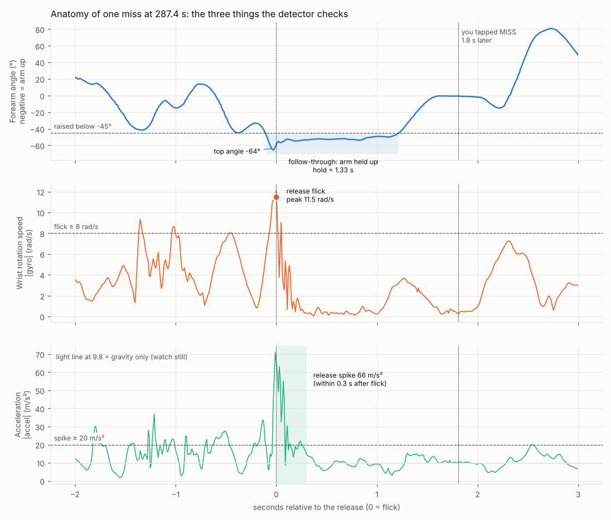
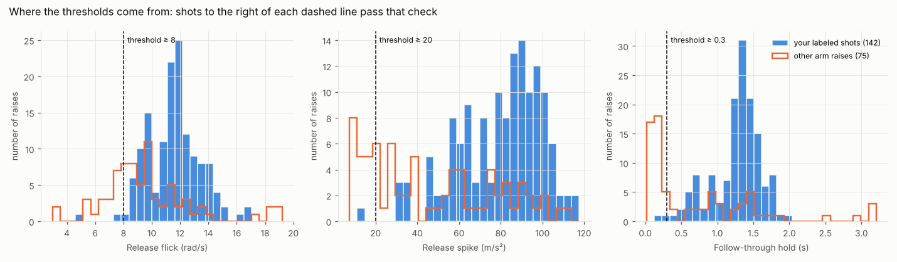
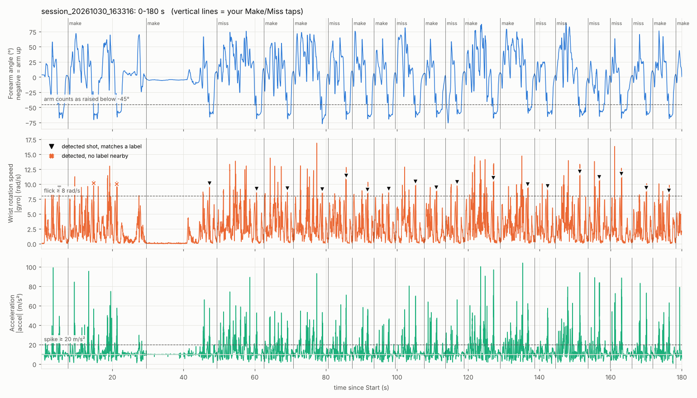
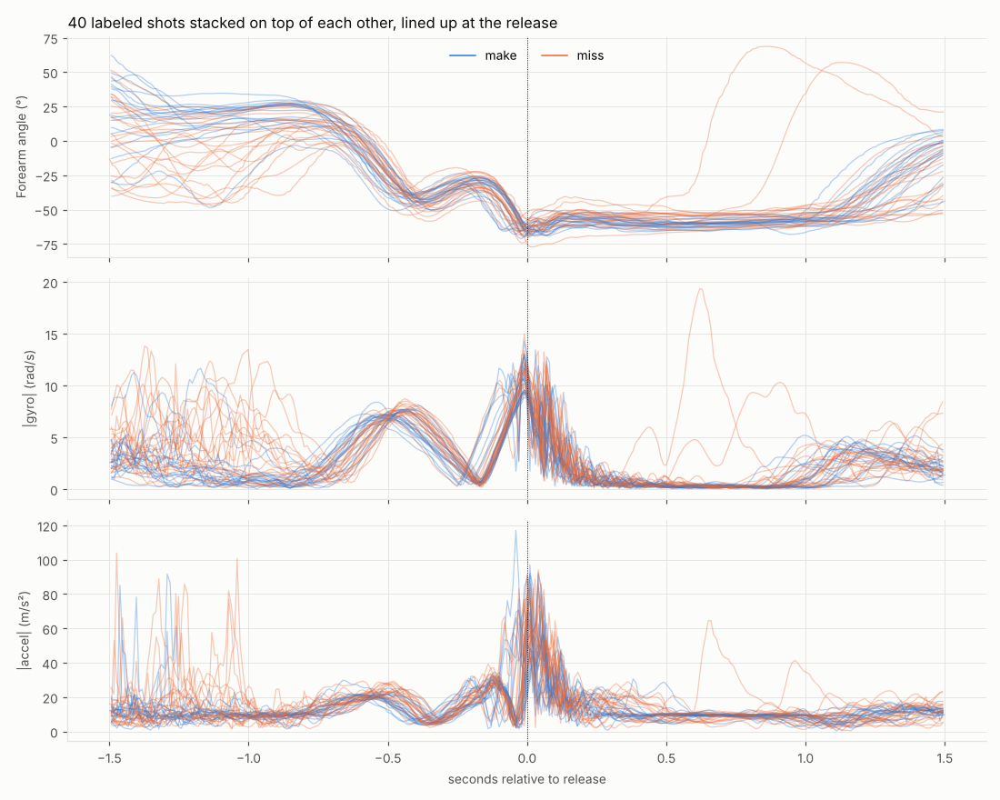

# Reading the plots

Every figure here comes from your session `recordings/session_20261030_163316`
(43 min, 144 labeled shots). `python analyze_session.py <session>` makes the same
figures for any session, in `analysis/output/<session>/`.

## 1. From raw sensor numbers to the three lines you see

The watch writes about 100 rows per second to `_raw.csv`. Each row has three sensors,
each with an x, y and z value (see the README's file-format section). Three numbers are
plotted, each computed from one row:

| Line on the plots | Computed from | Unit | What it means |
|---|---|---|---|
| **Forearm angle** (blue) | gravity `grav_x, grav_y, grav_z` | degrees | `asin(grav_x / 9.8)`. The watch's x axis runs along your forearm, so this is how far your forearm points up or down. On your right wrist, **negative means the arm is up** (about −60° at a shot), positive means the hand is lower than the elbow. |
| **Wrist rotation speed** (orange) | gyro `gx, gy, gz` | rad/s | `√(gx² + gy² + gz²)`: how fast the wrist is turning, in any direction. 1 rad/s ≈ 57°/s, so a 12 rad/s flick is about two full turns per second. |
| **Acceleration** (aqua) | accel `ax, ay, az` | m/s² | `√(ax² + ay² + az²)`: how hard the watch is being pushed. It includes gravity, so a **still** watch reads **9.8**, not 0. 20 m/s² is about 2g. |

The √(x² + y² + z²) step (the *magnitude*) removes direction, so it doesn't matter
how the watch is turned on your wrist. Before plotting, the rotation speed is averaged
over the last 3 samples (0.03 s) and the angle over the last 5 (0.05 s) to smooth
out sensor jitter. The watch does exactly the same live, so the plots show what the
watch "sees". The plots are drawn with matplotlib (`analysis/plots.py`).

## 2. Anatomy of one shot: what the detector checks

Time 0 is the release. Reading top to bottom:

* **Top (arm angle):** before the shot your arm goes up and down while you gather
  the ball. Just before 0 it drops below the dashed −45° line (the blue shading)
  and **stays there for 1.33 s**: your follow-through. That duration is
  **`hold_s`**, and it has to be at least 0.3 s. The lowest point, −64°, is the
  **top angle** (how high the arm got).
* **Middle (wrist rotation):** the dot at 0 is the **release flick**, 11.5 rad/s.
  It must be at least 8 rad/s (dashed line). The smaller bumps before it are
  you bringing the ball up. Right after the release the wrist is almost still
  (near 0): your hand holding the "gooseneck".
* **Bottom (acceleration):** the **release spike** is the biggest value in the
  shaded 0.3 s after the flick: 66 m/s² here, and it must be at least 20.
* The thin vertical line at 1.8 s is when you tapped **MISS**.

A raise counts as a shot only if all three pass: **hold ≥ 0.3 s, flick ≥ 8 rad/s,
spike ≥ 20 m/s²**, and the previous shot was at least 2 s earlier. Dribbling and
catching also make big flicks and spikes, but with your arm down (positive angle),
so they never get past the first check.

## 3. Where the thresholds come from

Each panel is a **histogram**: the x axis is a measured value, and the bar height
is how many arm raises had that value.

* **Blue bars** = the arm raise just before each of your labels (142 of 144 labels
  had one): your real shots.
* **Orange outline** = every other time your arm went above −45° (75 of them):
  reaching up, rebounds, maybe unlabeled shots.
* **Dashed line** = the threshold. Raises to the **right** pass that check.

A good threshold sits left of almost all blue bars, so you don't lose real
shots, while cutting off as much orange as possible. The **hold** panel shows the
clearest split: real shots hold about 1.3 s, while most other raises last under
0.3 s. The **flick** panel overlaps more, so on its own it would be a weak test;
that's why the detector combines all three.

## 4. A session timeline

The first 3 minutes. Each vertical line is one of your Make/Miss taps (named at the top).

* Every shot shows as a **dip in the blue line below −45°** about 2 s before a tap.
* **▼** on the orange line = a detected shot that matches one of your labels.
* **✕** = a detection with no label nearby: either a missed label or a false alarm.
  The two here, at about 15 s and 21 s, were at the very start of the session.
* 30–45 s: the flat lines are the watch sitting still (rest).

For the full 43 minutes see `overview.png`. It's too dense to read zoomed out;
open it with `--show` to zoom with the mouse, or pick a range with
`--zoom 600 780`.

## 5. All your shots on top of each other

Forty shots (blue = make, orange = miss), each shifted so its release is at 0.
When the lines bunch tightly, your motion was the same every time. Yours
bunch very tightly: the same gather (rotation bump at −0.5 s), the same dip at
−0.2 s, the same release and the same ~1 s hold. This consistency is what
Phase 5's form score will measure, and the separate lines that peel off around
+0.6 s are shots where you dropped your arm early.

Makes and misses look almost identical here. That's expected: the wrist only
shows part of a shot, and that's why the app never guesses make/miss from motion.

## 6. The numbers in the text report

| Number | Meaning | Your session |
|---|---|---|
| **true pos** | detections that match one of your labels | 139 |
| **false pos** | detections with no label within 6 s after them | 25 |
| **missed** | labels with no detection before them | 5 |
| **precision** | true pos ÷ all detections: *when it says shot, how often is it right?* | 139 / 164 = **85%** |
| **recall** | true pos ÷ all labels: *of your real shots, how many did it find?* | 139 / 144 = **97%** |
| **F1** | one number combining both (their harmonic mean); 1.0 is perfect | **0.90** |
| **p10 / median / p90** | 10% of shots are below p10, half below the median, 90% below p90 | e.g. hold: 0.73 / 1.33 / 1.65 s |
| **label_delay_s** | time from release to your tap | median 2.2 s |

A detection matches a label when the label comes up to 6 s after it (or up to 1 s
before). Some "false positives" are probably real shots you didn't label, so true
precision is likely higher than 85%.
